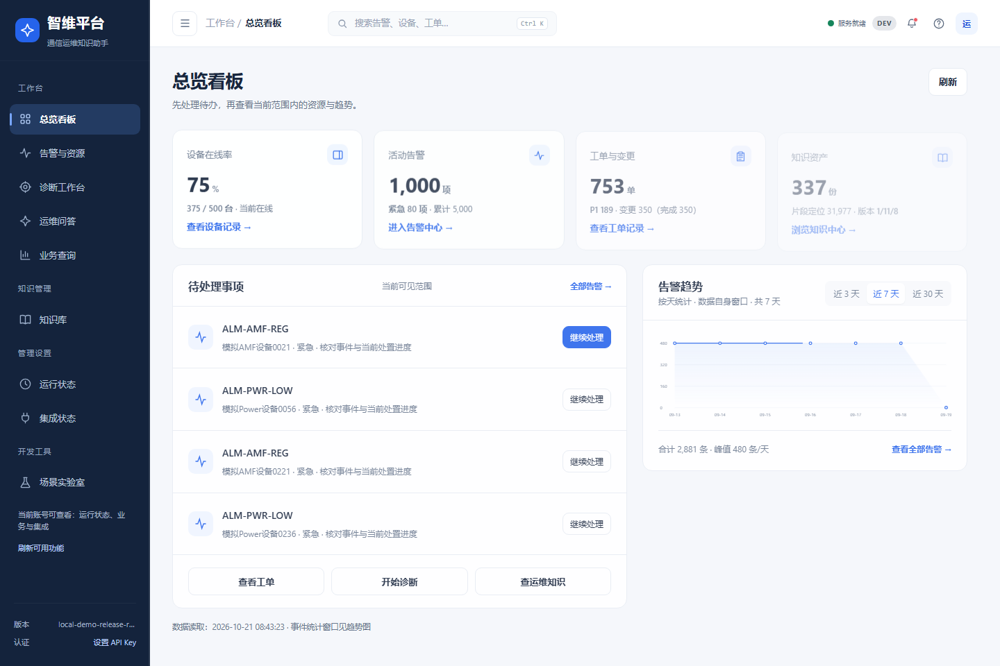
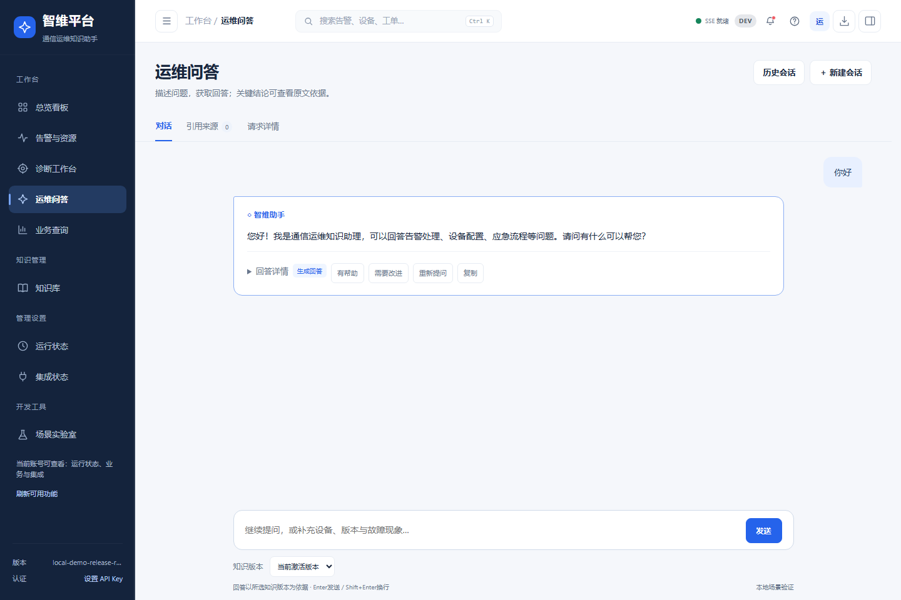

# 智维 · 通信智能运维平台

面向通信网络运维场景的个人训练项目，包含知识问答、告警与工单、规则诊断、受控查询和知识治理。

本仓库保存当前源码快照。项目中的业务案例用于模拟训练；本地演示、开发回归与独立质量评测分开记录，不声明客户生产上线。



## 功能

| 模块 | 实现内容 |
| --- | --- |
| 工作台 | 指标、告警趋势、待处理事项与业务跳转 |
| 告警与工单 | 事件详情、关联设备、诊断记录、工单草稿、处理与恢复验证 |
| 运维问答 | FAQ、混合检索、引用溯源、SSE、多轮会话与本地草稿 |
| 诊断工作台 | 业务快照取证、结构化候选判断、人工复核和诊断记录 |
| 业务查询 | 自然语言转 QuerySpec，确认条件后执行受限只读查询；五类固定统计 |
| 知识管理 | 原文查看、分步暂存、候选兼容检查、Worker 进度与账本 |
| 治理与权限 | 问题复测、案例审核、版本门禁、发布/回滚计划、按角色开放入口 |

界面以蓝色为主，统一侧栏、消息阅读列、加载与抽屉动效，适配窄屏并支持减少动画偏好。



## 技术栈

Python、FastAPI、MySQL、Redis、Milvus、BGE-M3、BM25、RRF、BGE Reranker、SSE、Docker Compose；前端为 HTML/CSS/JavaScript。生成可对接 OpenAI 兼容 API，具体模型与费用由本地配置决定。

## 目录

```text
app.py              FastAPI 应用入口
qa_core/            API、检索、生成、权限、诊断、入库与版本治理
static/             实际前端页面与公共组件
scripts/            初始化、迁移、数据生成、评测及本地运维工具
docker/             MySQL 初始化结构
config/environments 环境配置模板
scenarios/          场景配置
tests/              单元、组件、集成与浏览器检查
docs/               架构、接口、数据治理与验收范围
```

## 新环境准备

需要 Python 3.12、Docker Desktop/Compose 及按模型授权另行准备的本地模型。以下是新的独立开发环境准备步骤；本仓库不携带当前演示机器的数据库、向量、模型或批准记录。

```powershell
python -m venv .venv
.venv/Scripts/python.exe -m pip install -r requirements.txt
.venv/Scripts/python.exe scripts/init_local_env.py --environment dev
$env:APP_ENV_FILE = '.env.dev'
```

初始化器会生成随机口令，拒绝覆盖已有文件。编辑 `.env.dev`，核对存储地址、模型目录和鉴权配置。初次检查建议设置 `GENERATION_ENABLED=false`、`AGENT_ENABLED=false`，保持 `AUTH_REQUIRED=true`；需要生成时再在本机填写 `LLM_API_KEY`。

```powershell
# 仅启动新环境所需的存储；不会运行历史发布控制器或 Worker
docker compose --env-file .env.dev -p zhiwei-dev up -d mysql redis etcd minio milvus

# 模型目录准备后，初始化空集合并创建自己的运维凭据
.venv/Scripts/python.exe scripts/init_collections.py
.venv/Scripts/python.exe scripts/create_api_key.py --user ops01 --roles ops

.venv/Scripts/python.exe -m uvicorn app:app --host 127.0.0.1 --port 8010
```

浏览器访问 `http://127.0.0.1:8010/`，在页面中设置刚创建的凭据。新环境没有历史业务记录或已发布知识，空数据提示是预期行为；知识问答需要完成自己的资料处理、准入、索引及版本流程。生成业务训练资料可参考 `scripts/generate_enterprise_dataset.py --help`，这不等于批准资料入库。

`scripts/start_platform.ps1` 等历史受控入口依赖本机发布选择、准入凭据和哈希快照，无法直接替代上述新环境初始化。不要从版本库恢复别人的登录文件或复用历史批准记录。完整说明见 [环境隔离](docs/ENVIRONMENT_ISOLATION.md) 和 [数据治理](docs/DATA_GOVERNANCE.md)。

## 验证与边界

可运行不依赖演示库的部分单元测试：

```powershell
.venv/Scripts/python.exe -m pytest tests/unit/test_alert_handling_state.py tests/unit/test_diagnosis_judgment.py tests/unit/test_ingest_workspace.py tests/unit/test_version_workspace.py tests/unit/test_candidate_write_guard.py -q
```

浏览器检查脚本位于 `tests/browser/`。其中 `blue_shell_smoke.cjs --motion` 使用隔离接口；`blue_live_readonly.cjs` 连接已配置好的真实本机服务，不能在空数据库上等同复现既有演示结果。

本地最近一轮有 276 项隔离浏览器检查、26 项真实服务检查和 24 项运行准备单元测试通过；问答比例修正另有 23 项布局检查。这些是各自范围的开发验收，不代表独立答案质量或全部写操作验收。真实管理员发布/回滚、新一轮完整入库及独立质量仍有未覆盖范围，见 [第四阶段记录](docs/UI_BLUE_P3_2026-10-21.md)。

## 上传范围

包含源码、测试、配置模板及必要文档；排除 `.env*` 私密配置、API Key、`.runtime/`、模型权重、原始语料、冻结候选包、数据库/向量快照、私有评测题集及原始运行报告。文档中的本机路径与运行证据链接属于历史记录，源码仓库不含这些私密产物，不能视为克隆后已经存在。

[架构](docs/ARCHITECTURE.md) · [API](docs/API_CONTRACT.md) · [数据模型](docs/DATA_MODEL.md) · [仓库审查](docs/REPOSITORY_AUDIT.md)
