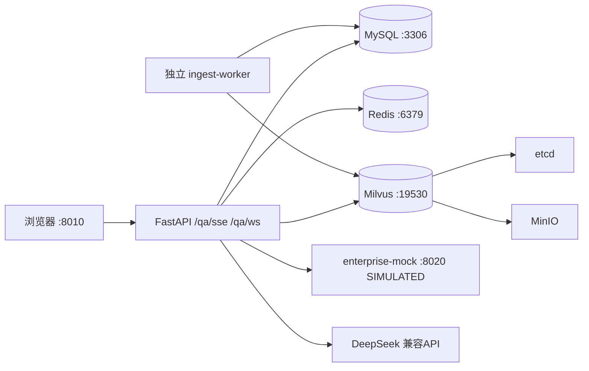
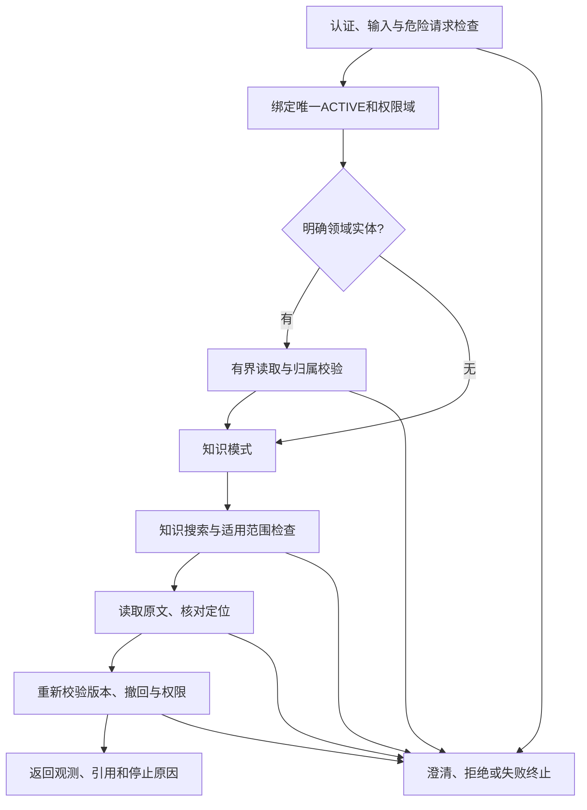

# ARCHITECTURE — 架构与调用链

## 1. 容器拓扑



原项目`telecom-ops-rag`共8个服务，使用工作树的`.env.runtime`重启。容器间走服务名；代码来自当前工作树，模型/场景/数据/报告来自`F:/heima/myproject`挂载，容器内场景固定为`/app/scenarios`。镜像使用CPU Torch；启动按embedding→rerank→intent顺序预热，`/health`显示组件及intent就绪状态。

test存储使用独立项目、MySQL13306、Redis16379/DB15和Milvus29530。协议开发集合为`test_protocol_r1_doc`/`test_protocol_r1_faq`，管理员预览`v4-protocol-dev-r1`；宿主验证另启空闲回环端口，不复用较早的18010进程。历史运行证据保留于本机；新克隆的配置与范围见[环境隔离](ENVIRONMENT_ISOLATION.md)。

## 2. 包结构与职责

```text
app.py                  FastAPI 入口、lifespan 装配、路由注册
qa_core/
  config/               pydantic-settings；APP_ENV_FILE选择配置、环境变量覆盖；scenario加载
  schemas/              pydantic 模型：请求/响应/意图/检索/事件
  domain/               租户/组织/设备/告警/工单/变更/知识资产统一领域模型
  api/                  route_qa、route_kb、route_alerts、route_domain、route_admin
  application/          用例编排：QaUseCase（在线主流程顺序的唯一实现处）
  intent/               规则通道 + 模型通道(灰区兜底) + apply_intent_decision_gateway
  rewrite/              归一化、注入扫描、缩略语表、多查询变体、多轮指代改写
  retrieval/            milvus client、dense/sparse 召回、hybrid 融合、标量过滤、去重
  rerank/               CrossEncoder 封装、批处理、低分保护
  generation/           上下文构建(8K 预算)、提示词模板、LLM client(OpenAI 兼容)、生成后核验
  indexing/             parsers/(六类解析) chunkers/(六类切分) embedder/ loader/
  storage/              平台 DAO + 企业领域快照/上下文 DAO、redis client、kb_version 状态机
  memory/               会话历史（最近3轮窗口）
  quality/              门禁五项 + 报告生成
  cache/                L1 进程内配置缓存、L2 redis key 构造与失效
scripts/                rebuild_kb.py、init_collections.py、run_quality_gate.py、run_eval.py、review_bad_cases.py
tests/                  unit(纯逻辑) / component(真连接) / integration(端到端) / smoke
scenarios/              telecom_ops.yaml（意图词表、阈值、hybrid 权重、提示词模板）
docs/                   契约六件套
```

## 3. 在线问答调用链（`application/qa_usecase.py` 唯一顺序）

```text
请求 → HTTP/WS 共用认证 → RBAC 角色门禁 → ABAC 有效访问域 → api 校验(E001/E002/E003)
     → rewrite: 归一+注入扫描+缩略语展开(+多轮指代改写)
     → intent: rule_score → 灰区才走 model_score → apply_intent_decision_gateway → route
     ├─ direct_answer → 固定话术返回
     ├─ faq_exact → FAQ 检索 → 阈值判定 → 直出 / 降级 retrieval
     ├─ structured_lookup → Milvus Query(alarm_code 精确) → 命中返回 / 降级 retrieval
     └─ retrieval:
        active kb_version 读取 → 多查询变体(≤3)
        → Dense(ef=64,top50) + BM25(top50) → Weighted Hybrid(0.6/0.4, 按doc_type可调)
        → Milvus 标量预过滤(租户/角色/部门/密级/设备域→kb_version→doc_type/network_tech)
        → 去重(parent_id 级)
        → Reranker(top_n=5, 截断512) → 低分(<0.30)保护
        → 上下文构建(8K 预算) → LLM(流式) → 生成后核验(码/条款回查)
        → 同步路径核验失败可重生成1次；SSE不重生成，核验失败转引用模式
     → 组装响应(answer/sources/route/intent/diagnostics) → 记录 trace + messages 表
```

## 4. 离线入库调用链（持久化任务 + 独立 Worker）

```text
API 上传/重建请求 → ingest_jobs(pending) → 立即返回 job_id
→ 独立 ingest-worker 以 SELECT ... FOR UPDATE SKIP LOCKED 原子领取
→ 扫描 data/raw → file_hash 幂等检查(ingest_records)
→ parser(按 doc_type) → chunker(按 doc_type) → 脱敏扫描(手机号/IP/密码)
→ embedder(BGE-M3, batch32, L2归一) → loader 写入 FAQ/DOC Collection
→ ingest_records 状态推进(pending→parsed→chunked→embedded→loaded→done)
→ 建立 kb_version=STAGED → run_quality_gate 五项
→ 持续写入 stage/progress/heartbeat → success 或 failed
→ 全部通过 → 人工/命令激活 ACTIVE（审计写 kb_versions + 审计表）
```

队列只依赖 MySQL：唯一幂等键避免重复排队，文件哈希避免重复 chunks；Worker 默认单并发、上限 4。失败在上限内进入 `retry_wait`，错误最终可查询并手动重试；运行任务超出租约会在 Worker 重启时恢复。取消只在文件边界生效，避免打断单次 Milvus 写入。

第 6 步数据集将模拟工单按 50 条分片，缩短文件级租约和恢复边界。CPU 嵌入根据当前文件最长 chunk 自适应 batch：短文本 64、中等文本 32、长文本 8；Worker 限制 OpenMP/MKL/OpenBLAS 线程，避免连续长文本编码造成原生内存峰值。内容去重使用稳定 SHA-256，不使用进程相关的 Python `hash()`，也不把相同告警码误当成重复工单。

数据生成与发布链路：

```text
官方链接索引 + 自编知识卡 + 模拟领域数据
→ 确定性生成（generator_version + seed）
→ 离线治理门禁（哈希/来源/PII/重复/引用/泄漏/规模）
→ MySQL 领域快照幂等导入
→ Worker 解析、切分、向量化
→ 在线门禁
→ ACTIVE / ARCHIVED 版本切换
```

知识Chunk携带访问域、来源、业务关联、资产身份、审核状态和原文位置。检索器对实际schema构造过滤；证据接口缺少完整身份/schema时拒绝读取。旧库5,477行已按原向量复制到完整schema并行集合，但缺注册身份的行仍为draft/pending，未接管原ACTIVE。后续须先治理来源与审批，再形成内容/配置绑定的候选门禁与发布，避免清卷重建。

四篇实际批准摘要已在独立`test_step5_12d4f514c5d1`演练发布/撤回/安全回滚。其限定门禁重新验证批准凭据、正文哈希、元数据及实际入库记录；告警抽检不适用，不能替代原库通用门禁。撤回会使来源读取失效，并阻止回滚到仍含撤回资产的版本。

## 5. 企业业务上下文链路

```text
CMDB/监控/告警/工单/变更快照 → EnterpriseSnapshot(Pydantic 校验)
→ DomainDao 单事务幂等写入 → MySQL 领域关系表
→ /domain/alarms/{id}/context 或 /domain/devices/{id}/context
→ 强制 tenant_id 过滤 → 聚合设备/告警/工单/变更/有效知识
```

CMDB 设备属性与监控指标保持结构化查询：设备关系和实时数值不被切分、嵌入或写入 Milvus；仅审核后的知识资产进入向量检索。

## 6. 组件职责边界

| 组件 | 只负责 | 不负责 |
|---|---|---|
| Milvus | 向量+标量检索、BM25 | 精排、答案 |
| Reranker | 召回后精排 | 入库、替代 Milvus |
| Redis | 检索/语义答案缓存、限流、最近会话窗口 | 持久化业务与消息记录 |
| MySQL | 会话/反馈/版本/评测/工单记录 | 检索 |
| LLM | 依据上下文生成 | 事实来源（只准引用证据） |

## 7. 三级缓存

L1 进程内（scenario 配置/规则/映射表）→ L2 Redis（`emb:` 24h、`ret:` 10min、`faq:` 1h，候选类 key 含 kb_version 与完整 ABAC 权限摘要，TTL 抖动 ±10%，空结果缓存 60s 防穿透，互斥锁防击穿）→ L3 语义缓存（仅复用已核验答案，也按同一权限摘要隔离）。Redis 故障 → 缓存旁路直连。

## 9. 权限决策与审计链路

```text
API Key / 开发 Header
→ AuthContext(user/tenant/roles/depts/devices/levels)
→ AccessScope（角色密级上限与请求范围取交集）
├─ require_roles：接口级 RBAC
├─ Milvus expr：召回前 ABAC
├─ cache fingerprint：跨权限缓存隔离
└─ permission_audit：允许/拒绝、原因、权限域、query hash
```

会话 ID 在服务端以 `tenant_id + user_id + 客户端 session_id` 派生，避免猜测 ID 复用其他主体的上下文。审计写入故障不阻断问答主链路，但审计接口会明确返回迁移缺失或数据库不可用。

HTTP SSE每进程最多5个同步后台工作线程。第6路返回429；断连停止向客户端发送，后台同步操作退出后才释放槽位，避免继续运行的模型请求被漏计。总超时120秒，前端失败后提供手动重试。真实4次模型开发回归已验证正文流、终态及来源重鉴权；Token用量未采集，少量观察不输出P95或SLA。来源通过独立`sources`事件返回，`done`携带最终答案与诊断。
## 8. 企业系统集成边界

```text
SIMULATED Wiki / CMDB / Alarm / Monitoring / Ticket / Change
                         │ HTTP + cursor + contract
                         ▼
             EnterpriseAdapter Protocol
                         │ normalized snapshot
                         ▼
              EnterpriseSyncService
                  ├─ DomainDao → MySQL
                  └─ SyncStateStore → cursor/status/error
```

问答核心只依赖统一领域数据，不依赖模拟服务实现。未来接入真实系统时替换 Adapter 的 HTTP 认证、端点和字段映射即可，问答路由与检索逻辑无需修改。模拟服务故障不会使 API 进程退出，而会形成可查询的 `degraded` 状态。

## 10. 只读 Agent 诊断闭环方案与首个实现（2026-10-08）

本节保留17.11设计边界；17.12已实现公共领域服务、4工具、有限状态编排与同步诊断API，默认关闭、仅隔离test启用。当前没有Agent前端/MCP/业务动作；领域实际表为空，完整领域测试使用临时夹具与向量证据替身。首个实现采用现有Python/FastAPI内的确定性有限状态编排，不新增框架依赖；模型选工具、MCP、业务动作和Agent页面另行安排。默认关闭模型生成，输出经校验的观测、知识摘录、待核对项及引用，不将相关性直接判断为根因。

### 10.1 可复用能力与实际数据条件

| 能力 | 当前实现 | 首个闭环使用条件 |
|---|---|---|
| 认证与访问域 | `api/auth.py`、`security/policy.py` | 服务端AuthContext和有效AccessScope，允许ops/auditor/admin；admin也不跳过租户/访问域 |
| 告警/设备上下文 | `api/route_domain.py`、`storage/domain_dao.py` | 提取公共只读服务，先补关联对象过滤、缺失归属拒绝、分页/体积上限、审计和超时；不能直接开放DAO |
| 知识搜索 | `api/route_evidence.py`、`application/evidence_service.py` | 复用版本绑定、精排阈值与SOP护栏，Agent适配层还需补充诊断条件/覆盖判定（现有EvidenceService只返回证据，不保证充分性）；首版只读取请求开始时唯一ACTIVE，不提供STAGED预览 |
| 原文校验 | `EvidenceService.source`、`schemas/evidence.py` | 复用内容绑定evidence_id；引用前和结束前重验权限、资产、修订、哈希、撤回及版本状态 |
| 安全规则与追问 | `intent/rules.py`、`rewrite/conversation.py` | 先拦截危险请求；首版Agent单轮请求，不自动读QA会话，缺实体用澄清补齐 |
| 审计 | `security/audit.py` | 当前写入失败被吞掉，不能声称审计成功；Agent增加可观察的写入结果，不更改既有QA降级策略 |

2026-10-08只读SQL清点：`test_legacy_stage_fb36d947ab67`唯一ACTIVE为`test-legacy-demo-r1`，default租户知识资产256，devices/alarms/monitoring_metrics/work_orders/change_records均0，knowledge_relations为0；enabled Key=0，生成关闭。报告为`.runtime/test/reports/readonly-agent-plan-20261008/inventory.json`。知识正文、向量数量和ACL沿用17.10实测，本次只清点领域表，不冒充重新验证向量或重新跑932项单元。

因此当前隔离入口支持知识模式；请求明确alarm_id/device_id而实体不存在时不伪造观测，也不悄悄降为知识回答。临时领域夹具只用于独立测试库的开发回归，标记synthetic；不向已批准演示库同步业务记录，不将旧20份pending参考卡或Lab资料引入测试真值。

### 10.2 工具白名单与职责

工具参数使用严格Pydantic模型、extra=forbid；工具名由代码枚举。请求、工具文本和未来模型均不得传入tenant/roles/dept/security、数据库地址、任意URL/文件路径、SQL或凭据。权限、版本、deadline及限额由不可变服务端RunContext传入。工具调用走公共服务方法，避免内部HTTP循环与DAO绕过鉴权。

| 工具 | 允许参数 | 返回与边界 |
|---|---|---|
| `get_alarm_context` | `alarm_id`，1..64字符的受限实体标识 | 授权告警、设备及有权限的指标/工单/变更；alarm_id是事件主键，alarm_code不是主键，不按码任意挑一条告警 |
| `get_device_context` | `device_id`，同上 | 授权设备及有权限的关联记录；告警工具已返回设备时不重复调用，双ID不匹配即澄清 |
| `search_evidence` | `query`，1..500字符；`top_n`，1..3 | 从RunContext取固定ACTIVE版本，返回现有status/reason和证据；最多一次有依据的补充搜索，不按分数臆造证据 |
| `read_evidence` | `evidence_id`，1..2048字符 | 仅接受本轮搜索得到且未被移除的ID，返回经鉴权的定位与原文；结束阶段可再读同ID做重验，不开放任意引用下载 |

实体标识建议限制为字母、数字、点、下划线、冒号、连字符，拒绝路径/URL；如真实系统标识不适配，先明确映射再扩展契约。工具结果封装`status/reason/data/provenance/truncated`；不存在与不可见均用不可见实体空结果，内部trace可区分原因，客户端不泄露外租户实体存在性。503/异常不当作空证据。

现有普通搜索遵守top_n，流程搜索会返回完整SOP包，不按top_n截断。Agent需先核对包完整性和原文预算；需要超过3个引用才能完整支持的流程不在首版可回答范围，返回NO_EVIDENCE/evidence_budget，不截取前3片段冒充完整处置依据。普通诊断也须核对版本/设备/条件的适用范围，不能仅以EVIDENCE_FOUND认定可回答。

**17.11定位的领域服务前置（17.12已修复）：** `_apply_abac`目前检查主设备及知识密级/visibility，却未逐条限制工单/变更所属部门；缺主设备时没有设备范围判断。需统一tenant、部门、设备类型与字段白名单：请求方范围受限而主设备/归属未知时拒绝；工单、变更逐条过滤并验证关联设备，部门缺失不得默认public；无权限记录连同标题、关联ID均不返回。知识元数据不含正文，也不是已批准证据：只保留可见的关联提示，实际引用仍经EvidenceService验证。DAO中告警查询的工单/变更无LIMIT，以及变更关联子查询缺tenant条件，需补齐有租户约束的有界查询；时间排序必须使用实际列，ChangeRecord模型没有created_at，不将其当已提供的来源时间。

通用集成同步、工单创建/修改、发布/撤回/回滚、上传、命令执行和任意网络调用均不在白名单。审计、限流等运行记录可以持久化，业务数据/知识状态不由诊断调用修改；不承诺物理存储完全无写入。

### 10.3 有限流程、预算与停止规则



首版候选限额：每请求工具调用总计10次（领域最多2、搜索最多2、初读/终检原文共最多6），最终来源最多3个；总deadline90秒、单工具30秒；单工具序列化数据最多32KiB、全轮累计128KiB，领域每类列表最多20条。均为待实测的工程上限，不是性能成绩或SLA。最终校验的调用与输出体积也计费；没有足够预算完成重验就结束，不输出未经重验的回答。不能以裁剪SOP安全前提来满足体积上限；溢出时去除不完整证据并返回相应停止原因。

每次dispatch前消耗调用额度，错误同样计数；首版无自动重试。相同阶段相同工具和参数重复即`repeated_call`终止，终检阶段仅允许对应初读ID各重验一次。查询扩展只使用已授权实体字段和用户条件，全部搜索仍运行同一SOP判定；补充搜索不得改写成普通故障问题来绕开流程拒绝。明确证据不足或需要条件时尽早停止，不为耗尽预算循环调用。

采用进程内有界工作槽位与并发拒绝，复用现有SSE的占槽原则；本版先同步HTTP，槽位在实际工作退出后释放。取消/断连/deadline后不启动后续工具、不发送晚到结果；不能仅以async wait_for宣称同步SQL/模型已取消，需驱动读/连接超时、服务deadline传递与晚结果丢弃。CPU操作不能中断时维持槽位占用到退出；长操作验证及并发上限属于实现验收。

工具内容是数据：其中“忽略规则”“调用同步接口”“换版本/角色/URL”等文本不进入控制指令。输出模板只展示允许字段和当前证据，不能执行引用中的命令。首版没有模型计划或生成调用；未来加入模型必须另有调用/token预算、参数校验与现有GENERATION_ENABLED总开关约束。

### 10.4 出处、终态与可观测性

知识引用继续采用`evidence_id/document_id/source_revision/kb_version/location/source_url/synthetic`。结构化观测使用独立`observation_ref`（本轮工具调用ID、实体类型/ID、字段、读取时刻）、源系统及业务时间；sampled_at/occurred_at等只是记录时间，不能称最新同步时刻。设备和变更缺少实际采集时间时`freshness=unknown`，不补造时间；无实时验证时只说数据库快照，不说“当前设备故障已确认”。指标/工单/变更不伪造成知识evidence_id。引用可读不意味着内容适用或足以确认根因；安全流程仍需完整审批/回滚证据，200旧SOP维持missing_safety_controls拒绝。

若跨工具期间ACTIVE、读取绑定、撤回账本或授权发生变化，结束时丢弃已收集证据并返回`NO_EVIDENCE/binding_changed`或`access_changed`；不自动改用新版本重跑。每次工具都使用同一权限域，最终检查Key仍有效及当前有效授权未改变；引用详情继续重新鉴权。首版不使用Agent答案缓存或跨请求trace恢复，避免引入新的共享上下文。

| 结果 | stop_reason示例 | 行为 |
|---|---|---|
| ANSWERED | evidence_ready | 知识模式有可用引用，或领域模式有授权快照与适用引用；列明尚未验证的诊断条件，不保证根因 |
| NEEDS_CLARIFICATION | missing_entity / ambiguous_entity / entity_mismatch / missing_condition | 请求故障关联但没有明确实体ID、双ID冲突或流程缺条件；不暴露不确定实体/引用 |
| NO_EVIDENCE | entity_unavailable / insufficient_evidence / missing_safety_controls / binding_changed / access_changed | 不存在或不可见、覆盖不足、安全前提缺失、绑定或权限改变；sources为空 |
| OUT_OF_SCOPE | unsafe_request / prompt_injection | 危险请求/注入优先，工具调用0、sources为空 |
| DEGRADED | optional_context_unavailable | 只用于未承诺领域观测的知识模式，已有合格知识证据且可选功能失败，明确缺失；首版不主动读取可选领域数据 |
| FAILED | tool_error / timeout / call_budget / size_budget / repeated_call / audit_unavailable | 必需工具/审计失败、预算耗尽或重复循环；不展示半成品结论与引用 |

认证/接口级403/422/429/503保留HTTP错误；只有已接收并执行的诊断返回上表结构。断连无返回，内部记录`cancelled`作为停止原因，不扩展现有QA终态枚举。若用户已指定实体而领域服务失败，该实体为必需工具，返回FAILED，不降级伪装领域诊断。

返回trace为工具事件记录，不输出模型思维链：run_id、阶段、工具名、脱敏参数摘要/查询哈希、耗时、结果码、条数、剩余额度及stop_reason。持久审计记录认证actor、tenant和scope摘要、调用决策与绑定摘要；不保存Key、原始payload、自由文本、未授权记录或数据库凭据。结果仅返回本轮认证用户，首版不提供按run_id枚举/读取接口。Agent新增可观察审计适配器：开始/调用/终止审计失败时停止，返回audit_unavailable并丢弃结果；不把现有吞错函数返回None算作已审计。

### 10.5 实现顺序与开发验收（后端与只读入口已实现）

1. 增加`schemas/agent.py`、`application/domain_context_service.py`、`application/agent_tools.py`；提取现有领域/证据公共服务，先修上述领域权限、有界查询、可观察审计与超时前置。共享服务变化需跑既有领域/证据/权限回归。
2. 增加`application/agent_diagnose.py`确定性状态机与`api/route_agent.py`，注册同步`POST /agent/diagnose`；默认功能开关关闭，仅隔离test显式启用，保留GENERATION_ENABLED=false。不借用QA历史，不新增页面或SSE协议。
3. 在临时随机test库验证领域SELECT/权限；夹具带synthetic/固定时间/清晰预期，用依赖注入证据替身覆盖完整编排。再在已批准18011入口验证知识搜索+真实原文引用、认证拒绝和现有SOP安全拒绝，停止入口清Key。两类验证分开报告；领域数据库仍空时，不能声称真实领域+真实检索的端到端闭环已验。
4. 17.13已接工作台只读入口与trace简版，独立于QA会话和版本预览。需要新的领域数据、完整SOP、真实生成、MCP或业务动作时另明确数据/权限/预算。实现不得触发同步、重新入库、ACTIVE切换或候选passage重嵌入。

首版开发验收矩阵（全部dev/regression，独立frozen=0）：

| 组 | 必验输入/故障 | 必验结果 |
|---|---|---|
| 正常闭环 | 知识模式、授权告警/设备夹具、双ID一致、有依据的补充搜索 | 工具顺序、限额、引用原文定位、快照出处、明确停止；生成关闭时真实LLM调用0 |
| 澄清与安全 | 无实体ID的现场诊断、仅alarm_code、多候选、双ID冲突、缺流程条件、危险请求、工具正文注入 | 正确终态；危险请求0工具；注入不能新增工具、改变范围或绕过SOP |
| 权限 | 无Key、无角色、伪造Header、外租户、部门/设备类型限制、孤立告警、关联工单/变更不同部门、缺归属 | 401/403或不可见结果；未授权字段/关联ID/计数不泄露；主体来源为真实Key |
| 证据生命周期 | 非本轮ID、篡改ID、STAGED/ARCHIVED、撤回、正文漂移、阶段间ACTIVE/权限/Key变化 | 全链校验、空引用停止；不复用旧证据或自动切版本 |
| 资源与故障 | 领域/搜索/原文503、超时、断连、调用/体积耗尽、重复调用、并发满、审计失败 | 无后续dispatch、无晚结果发布、实际工作退出前不释放槽位；失败原因可见 |
| 内容边界 | SOP缺审批/回滚、无监控时间、旧模拟数据、知识关联但不可引用、证据适用版本冲突 | 不输出不安全流程或确定根因、不伪造采集时间；pending范围和批准资料不变 |

报告逐例请求/权限摘要、工具trace、预期与实际终态、引用校验、错误分类、代码/配置/夹具哈希和清理结果。仅能从开发题报告契约通过率、调用数、拒绝/澄清和引用可读性；不将夹具或已暴露FAQ计为独立质量、真实根因准确率、线上性能或生产容量。


### 10.6 17.12后端实现与验证范围

实现采用domain_context_service.py、agent_tools.py、agent_diagnose.py及route_agent.py，Agent公共请求/工具参数strict+extra=forbid，功能需agent_enabled/test/auth_required/真实Key全部满足。领域快照默认internal；主设备/归属、关联部门/设备/告警/工单和typed知识关系均检查，字段投影去除自由payload与人员ID，SQL有界并设驱动超时。新audit_access_checked返回真实提交结果，Agent失败即停止，QA仍best-effort。

普通诊断严格检索fault_case/manual，过滤标题/适用性标签，不回退SOP；流程仍完整安全核对。引用前及终态原文重读，hash/修订/身份、ACTIVE/manifest/撤回及授权变化停止。单轮一次搜索，可追加授权标识，第二轮搜索暂未启用；工具上限10/最终3来源、90秒/单工具30秒、32KiB/累计128KiB、列表20条、2工作槽位。断连/超时不派发后续工具，晚结果丢弃而实际工作退出前不释放槽位；超时先返回同一响应字段及预算快照、trace为空。

990全量单元与2项自身随机MySQL集成通过；后者真实领域/manifest/账本/审计、向量证据替身。18011最终热态真实知识3份模拟工单引用/7调用、原文200及认证/澄清/缺数据/危险/SOP拒绝通过，前后知识指纹不变，验收后停止清Key。冷加载超30秒的拒绝、标题缺陷和复验环境失败保留，预热后约40秒一次观测不作为SLA。独立frozen=0、领域表为空；下一项只读工作台入口/简版trace与浏览器回归。详情和产物见交接17.12。

### 10.7 17.13只读诊断工作台

静态AgentWorkspace独立于QA会话/预览版本，提交严格单轮请求；health能力为agent_enabled/test/auth组合，真实认证仍由后端决定。页面等待显示实际秒数、同步终态才展示工具事件，不伪造实时编排。知识摘录和结构化观测分开，观测显示实际出处、来源/记录与读取时间/时效/模拟属性，缺失不补造；原文逐次重新鉴权。使用textContent，结果不保存到本地历史。

AbortController取消/105秒客户端上限不自动重试，不宣称后台已退出；序号和Key快照阻止换Key、离页、新会话或取消后晚响应发布，原文响应使用相同边界。HTTP错误与状态/停止原因分别展示，失败/拒绝/澄清清掉旧事实，澄清问题单独呈现。97相关单元与真实Edge1280/390知识/三原文/工具记录/澄清/缺数据/安全/认证及原SSE追问通过，受控传输/观测探针单列；并未验证实际领域根因质量。复现脚本scripts/verify_readonly_agent_ui.py与清理/完整存储指纹结果见交接17.13。下一项先核对领域准入及完整端到端验收前提。

### 10.8 17.14领域接入准备与实际闭环前提

prepare_agent_domain_review.py仅离线生成pending候选与内容绑定验证，不执行sync/DB写入。历史生成快照中的工单/告警与变更/工单设备关系有1090处冲突，单列外键及旧“ID存在”检查不能证明关联一致；保留源输入，只挑12条原样一致行和4条新提议知识关系。目标既有租户/知识资产作为外部前提，排除原20pending参考资产。六适配器进程内契约核对、37相关单元及离线审核页通过；未在线证明完整领域+知识链路。

准入需新内容绑定确认，旧知识批准和publication快照不覆盖业务领域行。执行前实时核对目标、ACTIVE/manifest与资产身份/权限、候选ID不存在，再单事务insert-only写16条并另记领域指纹，禁止通用upsert改tenant/assets或sync_all引入Wiki。源UTC时间明确转换为SQL UTC-naive，当前模型没有真实逐行密级/模拟来源存储，测试观察仍internal/synthetic；不扩用到真实数据。文件资产typed关联不限制当前Agent检索到特定CSV记录，只有实际来源重读结果能作为摘录；不能因工单/设备关联而确认当前根因。12类拟定dev验收/前提/限制见candidate包acceptance-plan.json与交接17.14，需准入后执行，不作现成质量成绩。


### 10.9 17.15批准领域数据的只读闭环

仅限回执绑定的16条模拟行在test_legacy_stage_fb36d947ab67持久留存，未调用通用快照upsert。preflight和SERIALIZABLE insert-only单事务核验唯一ACTIVE、已发布资产/ACL、目标唯一ID及各表行数，同时写审批摘要审计。程序对已提交receipt拒绝重复apply。响应字段仍严格模型投影；知识关系表示文件级关联，不会自动把query-based检索钉到CSV个别工单。

真实告警/设备请求各返回五项模拟快照与三项重读核验引用；范围交集、双ID一致性、缺实体澄清、缺安全控制SOP、危险请求及受理后Key撤销回归通过。Edge显示来源出处/时间/时效/模拟标记，并在空值显示未知、长字段换行；1280/390无水平溢出。测试只验证本地快照读取链路，不表示线上契约、实时状态、根因质量或性能保证。当前报表确认既有256知识资产、4,390位置行、发布和引用撤回绑定、默认test库指纹不变；审计和领域候选为明确预期增加。API、临时Key/profile与本轮五个test容器已清理停机。验收细节见交接17.15。

### 10.10 17.16关联检索设计（未实现）

现有knowledge_for_entities只输出授权文件资产，丢失typed边来源；Agent search仍按query全域召回。离线提取17.15完成响应发现6引用关联文件内0，只是关系范围基线。下一实现批次补授权边及上下文指纹，服务端生成不可变检索约束，不新增公开工具/权限参数。无实体knowledge保持原路径；普通domain使用OR(asset_id,source_revision)；显式关联工单原文核对使用OR(asset_id,source_revision,ticket_id)，只接受本轮授权work_order身份。无候选拒绝、多候选无明确合法ID澄清，不从任意文件/问题ID推断记录关系。

资产约束与现有tenant/ACL/唯一ACTIVE/生命周期硬过滤相交，Dense/BM25、软条件重试与缓存再交集都保留。缓存键加入规范化成对/三元组清单及约束修订，禁止各列独立IN造成交叉组合。逐工具与发布前重验授权边/资产/领域上下文，同时保留原Key/manifest/撤回/hash及终态原文重读。关系变化清掉事实和引用，列表截断/身份不全不选任意前缀。

精确工单用有界强标量读取已有原文片段与定位，绕过语义排名与parent去重；全部片段齐全、记录无歧义且不超过3来源才发布，不能自行拼正文/token或只返回部分工单。复用既有ticket_id及位置表，无schema迁移/重嵌入。普通诊断限定文件不保证记录级命中；精确核对不产生相关性或根因质量分。工具/时间/输出预算继续10、90/30秒、3来源和32/128KiB；81授权实体、20资产/工单/目标三元组，超限或截断拒绝。

关联domain SOP只能使用关联SOP，此候选无SOP所以预期related_evidence_unavailable；knowledge/临时夹具中的不安全SOP仍missing_safety_controls。23类开发预期待执行，12项纯测试只验证离线基线/记录身份/绑定/转义。实际DOC标量与根记录强读为下一批前置；不得将离线50记录清单称当前向量验收。四步实现顺序与具体场景见[方案](../.runtime/test/reports/agent-relation-plan-20261009/plan.json)及交接17.16。

### 10.11 17.17关联检索实现与收口

架构10.10已落地：knowledge_edges_for_entities保存授权typed边来源，DomainContextService仅在Agent内部include_relations时附边；公开领域接口保持原投影。不可变EvidenceConstraint将成对资产/修订及精确工单三元组加入Dense/BM25硬过滤、软重试、缓存键和缓存再交集，空约束拒绝；服务端select_targets限定授权work_order并对多候选澄清。ReadTools绑定领域上下文指纹，逐工具/结束/审计后重验变化并清掉事实和来源。

精确工单不初始化查询模型，用Strong标量读全片段及原文位置；ticket/source、checksum、无歧义CSV定位与持久账本片段数完整一致，3来源预算内才发布，最终强读引用集合再比对。位置表opaque identity hash导致重复版本文件的保守计数可能拒绝，保持拒绝而不迁移schema或推断完整性。普通文件范围不保证特定记录，精确原文不形成语义或根因评分。预算与原权限/生命周期/审计/安全护栏不变，响应增量retrieval_scope只在成功时呈现。

1080单元、9真实临时MySQL、19批准库API及Edge1280/390通过；23类预期关联实际API、真实临时SQL或明确替身/传输探针，非独立质量评测。领域16行/知识原文/4390片段/向量/ACL/ACTIVE/共享test无变化，验收清自有API/Key/Edge目录并停回13容器。详细证据/失败保留及边界见交接17.17和agent-relation-implemented-20261009。当前本轮收口，无自动追加业务动作或功能。
