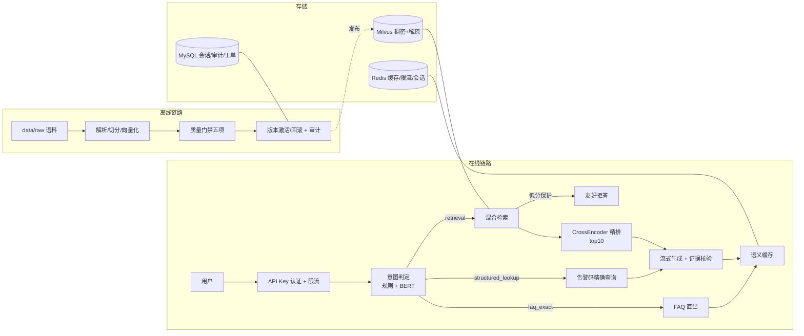

# telecom-ops-rag — 通信运维 RAG 知识问答平台

> 2026-10-20 侧栏调宽：左侧导航右侧新增拖拽边界，可鼠标/触控拉伸 200–320px，键盘 ←/→ 微调，双击或 Home 恢复默认；宽度写入 localStorage 并在首屏前恢复，移动端自动隐藏。前端回归 0 错误、零溢出。**刷新即可生效**。交接17.84、计划5.62。

> 2026-10-20 验收补验：**统计窗口统一**（含首尾 7/30 个日历日，卡片/分母/明细同源，实测 2881 一致）、**同范围明细**（告警日期区间 + 设备/工单正确跳转）、**主入口规则诊断**（不启用 Agent、不调用模型，告警→诊断→工单→恢复验证可走通）、**案例导出**（审核通过冻结 source_id 与 sha256，导出 fault_case_*.md 交资料入库）。补验 HTTP 27/27、主线链路 18/18、前端零溢出。**需重启 8010 生效**。见[补验报告](.runtime/test/reports/ui-acceptance-20261020/followup-20261020.md)，交接17.83、计划5.61。

> 2026-10-20 布局与体验收尾：**布局外壳稳定**（侧栏/品牌/页头固定，三宽度实测零抖动）、**会话抽屉与证据栏内嵌**（空态默认收起）、**工单页签**（待办/处理中/已关闭，我的工单）、**告警详情独立详情区**（返回保留筛选/页码/滚动）、**统计按最近有数据窗口**（标注数据窗口与分母）、**案例草稿闭环**（工单关闭→草稿→审核→资料入库）。前端全量回归 ok=true 零溢出。**需重启 8010 生效**。见[收尾报告](.runtime/test/reports/ui-product-review-20261020/closure-20261020.md)，交接17.82、计划5.60。

> 2026-10-20 业务闭环：**诊断判断结构化**（事实→候选→支持/反对/缺失→下一步，不自动定论根因）、**处置状态机**（待确认→处理中→恢复观察→已解决；观察失败回处理；未恢复不能关闭；验证依据强制）、**工单辅助**（草稿→人工核对建单→受理→回执→关闭验证，重复建单防护）、**差评驱动修复**（存原问题、服务端复测、人工关闭）、**五类固定统计**（公式/分母透明）、**诊断任务可重开**。前端全量回归 ok=true 零溢出。**需重启 8010 生效**。见[交付报告](.runtime/test/reports/business-closure-20261019/closure-delivery.md)，交接17.81、计划5.59。

> 2026-10-19 收口与打通：按复查意见先修风险再收架构——**统一授权作用域**（列表/统计/详情/查询/导出复用 dept+device_types，实测收窄 5000→250）、**收紧查询边界**（字段授权白名单、明细查询定位、聚合与超限条件明确拒绝、真实截断）、**告警处理闭环**（告警详情→诊断→证据→人工确认→处理记录→恢复观察，写入服务端账本）、**信息架构收拢**（工作台 / 知识管理含四子页签 / 管理设置 / 开发工具；告警与资源含设备清单；首页收敛为待处理事项与数据时间）。测试基线修复并新增断言，前端全量回归 ok=true 零溢出。**需重启 8010 生效**。见[收口报告](.runtime/test/reports/ops-recheck-20261019/closure-20261019.md)，交接17.80、计划5.58。


> 2026-10-19 P1/P2：新增**诊断工作台**（五阶段进度+证据账本+工具轨迹+人工复核+报告导出，隔离实测 ANSWERED）、**知识治理四 tab**（问答/资料/版本/缺口登记→补资料→回归→关闭闭环）、**查询工作台**（自然语言→QuerySpec→受控只读执行→导出；表白名单+字段白名单+强制租户过滤+limit≤200+审计）、**场景实验室**（授权撤回实测吊销后 401、缓存失效实测清 15 条、演示数据备份导出 JSON、角色视角）、移动端表格卡片化。新接口 `/query/parse`、`/query/execute`、`/backup`、`/kb/cache/invalidate`（**需重启 8010 生效**）。全量回归 ok=true、0 错误、0 溢出。见[P1/P2 报告](.runtime/test/reports/resume-demo-20261019/P1P2-20261019.md)，交接17.79、计划5.57。


> 2026-10-19 P0 演示主线重做（对齐参考 demo 的产品化外壳，保留真实后端）：新增真实只读接口 `/alerts`、`/alerts/{id}`、`/devices`（租户/角色/审计）；重做总览 v2（Hero + 4 主 KPI 可钻取 + 告警趋势 24h/7d/30d 段控 + 拓扑预览 + 待处置告警 + 知识/治理/问答三卡）；新增独立**告警中心**（汇总→筛选→表格→详情→创建诊断，不再依赖隔离服务）；产品壳（顶栏全局搜索 Ctrl+K/通知/导览/账号菜单）与动效系统（页面/卡片/图表/count-up/toast/骨架 + prefers-reduced-motion）+ 6 步演示导览。真实 Edge 验收 11+3+8 页全通过（0 错误/0 溢出/0 控制台错误）。**需重启 8010 生效**（新接口在新进程中）。见[P0 报告](.runtime/test/reports/resume-demo-20261019/P0-20261019.md)，交接17.78、计划5.56。


> 2026-10-19 内容与功能差距闭环：修复看板空租户 500 与跨租户计数、知识目录缓存不随入库失效、隔离工作区 dead-record 死锁；实测真实上传（STAGED 候选 + Worker success + 台账/目录）、隔离业务记录与只读诊断（ANSWERED）、同步/SSE/检索生成、凭据签发→吊销。完整交接仍因历史 cq 链在 r2 下绑定失效而阻断（已给出明确原因与恢复路径）。见[差距闭环报告](.runtime/test/reports/frontend-audit-20261019/content-gaps-20261019.md)，交接17.77、计划5.55。后端改动需重启 8010 生效。

> 2026-10-19 前端体验整改：按用户逐页审查清单完成四步整改——新增统一规范 `static/css/ui.css`（页头/按钮/输入/下拉/文件/状态/表格/空态/技术详情；正文 14px；黑底代码块退出主区）；重排 10 个板块的信息层级（总览指标全部可钻取、设备在线率删除假趋势；版本摘要/列表/详情/下一步/账本分层；评测版本→报告索引先行；权限凭据表置顶）；打通总览→业务/知识/问答、告警→诊断、文档任务→版本、评测版本→报告。真实 Edge 验收：1440×900 ops 10 页 + admin 3 页、390×844 ops 7 页，`ok=true`、0 错误、0 横向溢出、0 控制台错误；顺带修复访问管理整页崩溃、评测报告永不加载等真实缺陷。见[整改报告](.runtime/test/reports/frontend-audit-20261019/remediation.md)与[证据页](.runtime/test/reports/frontend-audit-20261019/review.html)，交接17.76、计划5.54。已知限制：隔离只读服务未启用（业务/诊断仅受限态）、激活版本详情约 11s、上传未做真实文件端到端。

> 2026-10-16 修复：Worker 启动锚定与观察者锁残留（r2 修订后暴露）——Worker 改锚 r2 受控链（修复前双击会在 Worker 环节超时失败）；残留旧观察进程（占 observer.lock 且持续 blocked）已清理。全链实测：prepare 30s → Worker 7s 就绪、r2 线上一键复验全通过（含"AMF 注册失败"【相关片段】+引用、域外拦截、catalog 冷2.59s/热0.28s）、单测 30 项通过。双击「启动运维平台.bat」即可。交接17.75、计划5.53。

> 2026-10-16 巡检调整与 r2 修订：13 项优化全部落地；问答"证据不足"从纯拒答升级为【相关片段】+出处（拒答降级），覆盖度修复（同案例覆盖率 0.2→0.6）；以受控修订 `local-demo-release-r2` 发布（历史绑定并集 55 项 + r1 交叉锁定；apply/rollback 可重放）。先读[交接17.75](docs/HANDOFF_2026-10-07.md)

> 2026-10-16 桌面一键启动/停止：新增 scripts/launch_platform.ps1 与桌面「启动运维平台.bat / 停止运维平台.bat」——双击即启动、已在运行时直接打开界面；检测到改版前旧实例会自动“停旧启新”（即本次加载看板所需重启，约1-2分钟）；运行日志 .runtime/launch-platform.log。交接17.73、计划5.51。

> 2026-10-16 控制台升级：新增**总览看板**（默认落地页，6指标卡+告警趋势+监控性能+级别/设备/路由分布+待处置告警+最近操作动态+知识治理，全部来自本机真实库表、内联SVG零外呼）；**知识中心/文档加载从 15 秒降到 ~3 秒**（冷启2.94s/命中0.25s，逐条校验与撤回语义按原契约保留）；版本下拉改为"当前激活：X"+列出全部版本与不可读原因（归档版本绑定旧集合，需经版本与发布回滚切换）；"业务与集成"改为入口页（用途/隔离原因/启用方式），"只读诊断"补充与问答的分工说明；各板块页头统一。见[UI验收](.runtime/test/reports/console-ui-20261016/browser-result.json)，交接17.72、计划5.50。**注意：需重启平台加载新接口与看板**（stop_platform.ps1 → start_platform.ps1，登录页会重新生成）。

> 2026-10-16 输入联想上线：右侧"业务上下文"告警/设备输入框支持联想补全——输入≥2字符即出候选（ID·代码·级别·状态 / 设备名·类型），↑↓/Enter或点击一键填入并立即查询上下文；`/domain/suggest` 与主库5000告警/500设备逐条比对一致，真实Edge键盘/鼠标/移动端端到端通过，外呼0付费0。启动自愈：记录PID被系统回收导致的"identity mismatch"启动死锁已可自动恢复（start_platform_runtime内建安全清理并留证，存活身份与8010被占用场景绝不改动）。见[验收报告](.runtime/test/reports/domain-suggest-live-20261016/review.html)，交接17.71、计划5.49。长驻仍需普通终端执行 `scripts/start_platform.ps1`，登录页以启动后新生成的.runtime/original-local/open-platform.html为准。

> 2026-10-15 演示发布版上线：`local-demo-release-r1` 已成为8010唯一ACTIVE（336份/4593片段＝继承306份4357片段＋20份draft-r2指南180片段＋10份新演示资料），完整五项门禁通过（alarm_recall/sop_integrity/meta_completeness/duplicates/desensitize），QA：31条FAQ精确、10条新设备内容检索命中、20条开发题19条有据可答、指南召回20/20，付费0。新增8份设备取证记录单（SIMULATED拟真）与2份公开资料中文自编摘要（NGAP/VSWR）；旧版local-content-quality-r1已归档，可经标准回滚接口恢复。治理链：候选包→审核包→批准收据→停旧→激活→启动→31项实时原文校验。入口链已切至`scripts.demo_release_runtime`；见[发布总结](.runtime/test/reports/demo-release-summary-20261015/review.html)（含[暂存验收](.runtime/test/reports/demo-release-stage-20261015/gate.json)与[审核包](.runtime/test/reports/demo-release-review-20261015/release-plan.json)链接）、交接17.70、计划5.48。

> 2026-10-15 AMF流程训练已接入业务工作区：16单元、39真实HTTP、28项Edge检查通过，八场景及实际导出/权限/沙箱/退出清理验收完成；资料与预算保持，付费/入库/发布均0。从[业务登录入口](.runtime/readonly-workspace/open-workspace.html)进入“流程训练 → AMF注册失败”；见[实际验收](.runtime/test/reports/amf-workspace-integration-20261015/review.html)，交接17.69、计划5.47。

> 2026-10-14新版预览完成：[独立只读入口](.runtime/sop-record-preview/open-preview.html)与[最终验收](.runtime/test/reports/sop-record-preview-topic-20261014/review.html)。20指南/180片段、109项取证/200步对齐可查看与跳原文；229单元，20/20公开开发题每条结果来源正确，已修复AMF混入其他专题。真实无窗口浏览器、隐藏停启/旧Key失效及重启后检索通过，模型已预热，付费0；交接17.66、计划5.44。当前控制器sop_record_topic_runtime，原8010保持，新版STAGED只读未发布。

> 2026-10-14已按具体批准完成：[20份draft-r2真实STAGED验收](.runtime/test/reports/sop-record-staged-20261014/review.html)，test-sop-records-r2新隔离库20来源/180真实BGE向量/109合同，106单元、67HTTP及20/20公开开发题检索引用通过，4临时Key清理。普通门禁仍失败，生成/Agent关闭，未合并或切8010，付费0；交接17.65、计划5.43。下一项接独立只读预览与新版支持性对齐。

> 2026-10-14第二步完成：[20份draft-r2具体审核页](.runtime/test/reports/sop-record-admission-20261014/full-content-review.html)及[准备验收](.runtime/test/reports/sop-record-admission-20261014/review.html)已就绪，独立新目标test-sop-records-r2，106相关单元/8无窗口Edge通过。原库、业务、指南及Key/PID保持，准入/入库/新STAGED/付费0；具体决定仍pending。交接17.64、计划5.42。

> 2026-10-14第一步完成：按训练项目定位，[业务工作区](.runtime/readonly-workspace/open-workspace.html)不再反复标注模拟数据，来源与权限仍保留；[20份指南修订稿](data/candidates/sop-record-revision-r2/review.html)新增49项具体取证，60→109，180本地分块/位置通过。见[本步验收](.runtime/test/reports/training-step1-20261014/review.html)，交接17.63、计划5.41；26单元、15HTTP、10Edge及隐藏启停通过。原8010/指南库不变，付费0；修订仍pending、未入库。业务Key已重发，后续启动用scripts/start_business_workspace.ps1，真实外部系统对接不列本训练项目必做项。

> 2026-10-14最新完善：同一[指南预览入口](.runtime/sop-guide-preview/open-preview.html)新增“SOP支持性对齐”，见[真实验收](.runtime/test/reports/sop-support-alignment-20261014/review.html)，交接17.62、计划5.40。20家族/200步骤、60取证项、双方条件与现场缺项可查；95单元、19网络HTTP、10Edge、382行引用/100不同片段通过。仅自有指南入口升级并重发技术凭据，旧封存代码、原8010/只读Key/角色/PID和知识不变，付费0。对齐是文字检查，现场证据与动作批准、独立质量分母仍0，STAGED未发布。新预览启停用scripts.sop_guide_support_runtime。

> 2026-10-14最新完善：20指南STAGED已有[本机管理员只读预览](.runtime/sop-guide-preview/open-preview.html)和[真实验收报告](.runtime/test/reports/sop-guide-preview-20261014/review.html)，交接17.61、计划5.39。目录/证据检索/原文与缺口贯通，8实时完整性、45单元、24网络HTTP、9无窗口Edge及自有进程停启通过。原8010/角色/Key/PID与候选知识保持，付费0；新库仅保留1个技术预览Key，4临时Key及浏览器profile清理。普通发布门禁仍未过，生成/Agent关闭，未发布或切换，完整现场资料/独立质量/长期观察仍有缺口。

> 2026-10-14最新执行：用户具体批准20份指南后，已在test_sop_evidence_r1新隔离库完成test-sop-evidence-r1 STAGED，[真实验收报告](.runtime/test/reports/sop-evidence-staged-20261014/review.html)，交接17.60、计划5.38。20来源/160真实1024维向量及原文位置相符，67实际HTTP处理器检查与20/20公开开发题主题来源匹配通过，4临时Key全部清理；付费0、原库/只读/原Key/PID保持。仅20指南，未激活/发布/切8010。普通发布门禁因无工单召回分母未过，SOP0不代表完整流程通过；生成/Agent关闭、独立冻结0，旧审核包pending快照保留，真实批准另记凭据。

> 2026-10-14准入准备：见[20份指南具体审核页](data/candidates/sop-evidence-admission-review-r1/review.html)和[验证报告](.runtime/test/reports/sop-evidence-admission-20261014/review.html)，交接17.59、计划5.37。新20份准确正文/身份/内部范围绑定，拟单独test_sop_evidence_r1隔离STAGED，仅20指南，不复制旧库，不切8010/发布/新增外发。31单元、8无窗口Edge及160真实tokenizer分块定位通过，guide类型保留，pending凭据阻断，目标库/集合实际不存在。具体决定仍pending，准入/入库/新STAGED/付费0；后续须记录这一准确内容与目标的准入决定，旧批准不扩大。

> 2026-10-14最新进度：完成[20份SOP取证分支待审正文](data/candidates/sop-evidence-drafts-r1/review.html)与[本步验收报告](.runtime/test/reports/sop-evidence-drafts-20261014/review.html)，交接17.58、计划5.36。覆盖200原件/20家族、60组具体记录；142单元、120开发模拟分支、9项无窗口Edge通过。新正文/身份/权限仍pending，未入库、STAGED或发布，完整现场SOP与独立人工质量批准0。今日既有容器停止及入口stale已按现有流程恢复，两个本机凭据重发，请通过[本机入口](.runtime/original-local/open-platform.html)重新进入；当前版本/知识/权限/环境/费用预算保持，付费0。已公开的新问题和模板加入v2曝光阻断。

> 2026-10-13最新进度：用户授权由助手拟定后，完成[开发自检与边界修复](.runtime/test/reports/development-selfcheck-20261013/review.html)，交接17.57、计划5.35。43/43组件、19/19真实只读HTTP、125单元、9项无窗口Edge通过；注入命令与自然天气查询识别已修复并在8010生效。仅隐藏重载，当前版本/配置/Key/知识权限不变，付费0；页面验证留下2个独立开发会话、8条消息。公开开发题不计独立分母，人工真值与冻结仍0，生成质量未测。后续哈希交接应使用 `python -m scripts.screen_question_holdout_v2` 纳入本轮曝光，原封存交接包不改。完整SOP、设备资料、合格整库增量/新配置发布和长期观察仍待办。

> 2026-10-13当前留出范围：按用户选择，另建[现有语料新问题交接包](data/candidates/known-corpus-question-holdout-r1/review.html)和[第四步报告](.runtime/test/reports/question-holdout-step4-20261013/review.html)，交接17.56、计划5.34。允许共享已准入来源/正文/主题，旧来源组隔离策略保持；不声称来源独立。A/B为匿名职责占位，实际审核凭据待核验。56单元、8项无窗口Edge与5类真实清单元数据控制通过，真实题集/真值/冻结0、指标null；下一步须由人工保管命题并另一轮审核，只交接哈希元数据。未运行QA、未付费或切换8010。

> 2026-10-13独立质量准备：见[交接17.55](docs/HANDOFF_2026-10-07.md)与[第三步报告](.runtime/test/reports/independent-quality-step3-20261013/review.html)。曝光登记、连通组隔离和空白人工命题/真值交接已准备；旧51条frozen记录排除，独立冻结分母0、指标暂无。24单元、8项无窗口Edge通过，零模型调用。下一项需要新适用来源与独立命题/审核，不能用旧开发题补独立分母。

> 2026-10-13最新内容进度：见[交接17.54](docs/HANDOFF_2026-10-07.md)和[第二步报告](.runtime/test/reports/sop-device-support-step2-20261013/review.html)。200份SOP（20正文家族）已逐份审查并核对实际存储，仍缺审批/回退及完整动作/恢复判据；8份新设备记录单pending，厂家型号手册与独立人工真值仍待补。19单元、8项无窗口Edge通过，本轮模型调用0，原入口未切换。

> 2026-10-12最新进度：六项完善顺序见开发计划5.24，工程页面与限定验收见5.25～5.30。第6项已接入具体来源审核、完整原件封包、五项门禁任务和发布/回滚计划及账本；真实隔离库的发布/回滚已通过。8010当前仅有相同FAQ增量及pending文件，门禁如实阻断，未切换原库；完整配置交接、SOP支持性、设备资料和独立质量仍有缺口。后台入口使用无控制台Python，并限制依赖子命令窗口；长期稳定性继续观察。
面向通信网络运维场景的**企业级场景验证项目**。原运行库现已完成合格回滚基线与新版发布，可用入口[本地8010](http://127.0.0.1:8010)，强鉴权；当前已恢复获准文档生成，Agent关闭。实际原库标准回滚、原文权限、真实SSE/页面和重启通过；这是本地演示，不声称客户生产上线或独立质量通过。当前结论见[首版总验收](docs/FIRST_RELEASE_ACCEPTANCE_2026-10-07.md)。

> **当前质量状态（17.27）：** 17.27已恢复获准的DeepSeek文档生成，保留17.26推荐绑定当前可读FAQ、原句精确匹配和明确主题保护。AMF真实浏览器SSE、SMF同步生成均通过，答案包含结论、排查步骤和引用，原文可读；本轮验证额度使用3/4（含1次TLS连接失败），生成成功2次，后续用户主动提问生成已获准。乒乓切换仍缺对应资料，明确NO_EVIDENCE且不调用模型。1239全量、71相关单元通过。最终路由标签及历史记录已修复，使用真实答案回放验证，无新增模型请求。原.env.runtime、ACTIVE/ARCHIVED、知识原文及向量未改，Agent关闭；整体资料覆盖和独立质量验收仍未完成。

当前开发位置为 `F:\heima\myprojectall\.codex\worktrees\783e\myproject`。先读[交接17.74](docs/HANDOFF_2026-10-07.md)。统一启动 `scripts/start_platform.ps1`（或双击桌面「启动运维平台.bat」：自动完成停旧启新、等待就绪并打开登录页），准备本机Docker、五个原存储、自有应用、专用Worker及后台观察；状态见[本地启动状态](.runtime/platform-entry/status.html)。重新打开[本地登录入口](.runtime/original-local/open-platform.html)，点击“进入平台”。入口恢复后Key已轮换，旧浏览器凭据可能失效；当前8010为local-demo-release-r1，生成开启、Agent关闭。统一停止用 `scripts/stop_platform.ps1`，存储保留。

只读诊断与业务使用[独立登录入口](.runtime/readonly-workspace/open-workspace.html)，读取此前批准16条领域资料及历史知识版本test-legacy-demo-r1；不把8010历史待审业务记录启用。独立启动 `scripts/start_training_workspace.ps1`，只恢复test五存储并启动127.0.0.1:18021；停止用 `.venv/Scripts/python.exe -m scripts.training_exercise_runtime stop`，保留存储。8010“业务与集成”提供该入口与状态。隔离入口禁用生成、同步、上传、发布和业务写操作，不提供生产根因判断。验收证据见[第5项报告](.runtime/test/reports/readonly-business-p2-20261012/review.html)。

“版本与发布”沿用管理员写入、审计员只读、ops受限的权限。完整原件包保存在独立工作区，pending文件不参加入库或封包，工程核对不能代替新资料准入。原入口禁止仅改ACTIVE指针切换读取集合；详细范围与真实发布回滚证据见[第6项报告](.runtime/test/reports/version-workspace-p2-20261012/review.html)。

> 2026-10-13剩余第一步：[完整8010配置交接准备报告](.runtime/test/reports/runtime-handoff-step1-20261013/review.html)。版本页管理员可准备当前/上一完整配置、报告和实时快照、具体失败恢复矩阵并重新核验；不含新的实际切换执行。当前候选无内容增量，旧不兼容pending任务保持隔离。已修正Docker冷启动的空版本退出码误判，并从既有卷恢复两个本机入口；未发布新版本、付费0，原/隔离数据与具体准入保留。

## 架构



## 当前验证口径

| 维度 | 结果 |
|---|---|
| 旧 r3 固定 dev 诊断 | Hit@5 **0.827**（62/75），未达旧 0.85 门槛；是已暴露开发题，不是独立冻结集。见 [`阶段 1 基线`](docs/STAGE1_BASELINE_2026-09-26.md) |
| 已批准协议开发样本 | 4 份自编短摘要、8 道已暴露 dev 题，隔离版本 `v4-protocol-dev-r1` 保持 STAGED；不能用小库结果代表整体质量 |
| DeepSeek 浏览器整链 | 隔离环境单题经 HTTP SSE 显示 `ANSWERED`，引用可重鉴权读取真实片段；页面首正文约 24.0s、终态约 25.5s，仅一次观察 |
| 双路真实模型观察 | 两道不同 dev 题同时请求，均 `ANSWERED`；首正文约 18.8/19.4s、终态约 20.6/20.8s；不是 P95、QPS 或容量证明 |
| 步骤1基线（2026-10-07） | 689项单元、15项相关真实存储/HTTP/浏览器集成通过，2项付费测试默认跳过；去重统计，初次集合配置断言失败与重跑已保留。条件与命令见 [`交接第11节`](docs/HANDOFF_2026-10-07.md)。默认旧向量集合缺完整证据字段，原文接口安全返回404；协议集合完整证据链通过 |
| 核心工作台（步骤2） | 深色侧栏、对话、证据详情、只读告警/设备、版本预览及反馈/手动重试已落地。35项相关单元、5项相关集成通过；1440/1280/390截图与测试条件见 [`交接第12节`](docs/HANDOFF_2026-10-07.md)，未调用付费模型 |
| 开发资料与尺子（步骤3） | 16个沙箱知识单元、52条带原文/权限绑定的dev草稿，全部pending、独立frozen=0。固定3384片段的只读Dense+精排诊断：目标命中32/32、必要证据完整22/32、19/32混入不适用分支；56项相关单元通过。API拒答/澄清终态与BM25/生成未测，不能作为正式质量成绩。见 [`交接第13节`](docs/HANDOFF_2026-10-07.md) |
| 检索与证据修复（步骤4） | 完成同24条已索引SOP dev的Dense/真实BM25混合/混合+精排对照，保留Weighted与原模型/阈值。另一套固定快照诊断中，完整证据22/32→32/32、分支干扰19/32→0/32，澄清/版本/权限本地护栏通过；733项全量单元、1项含6路径的真实存储集成通过。默认功能开关未开启、原运行环境未更新，真实生成与独立泛化未测；见 [`交接第14节`](docs/HANDOFF_2026-10-07.md) |
| 实际候选与原环境更新（步骤5） | 四篇已批准协议摘要在独立test沙箱完成真实入库/预览/限定门禁/发布/撤回/安全回滚；原项目八个容器已运行新代码和CPU镜像，入口 http://127.0.0.1:8010 ，重启配置`.env.runtime`。747项单元、1项真实Milvus连接集成通过，Linux镜像746项通过/1项因缺Node跳过。旧5,477行已复制完整schema但身份仍pending，未切原ACTIVE；原库引用404/证据检索503仍待治理，付费LLM未调用。详情与复现见 [`交接第15节`](docs/HANDOFF_2026-10-07.md) |
| 首版总验收（步骤6） | 750项全量单元、17项相关集成通过，2项原付费测试默认跳过；另以明确预算执行4次真实DeepSeek请求，答案与16次引用读取留档。20身份无LLM负载5获准/15返回429；原8010实际浏览器1440/390通过。可演示首版限定通过，原库完整引用与可信质量结论未完成；见[总验收](docs/FIRST_RELEASE_ACCEPTANCE_2026-10-07.md) |
| 只读Agent与工作台 | 17.12后端、17.13只读页面/工具记录已实现；本轮97相关单元、真实Edge1280/390三原文引用/澄清/缺实体/安全/认证及原SSE追问通过，受控UI探针另外标注。990全量单元和2项临时MySQL集成为17.12既有结果。18011显式开启Agent且生成false，当前停机清Key；已按独立准入回执写入16条隔离模拟领域/关系并完成真实API/引用回归；知识/ACTIVE不变，其他pending及独立评测继续。见[架构第10节](docs/ARCHITECTURE.md#10-只读-agent-诊断闭环方案与首个实现2026-10-08)及[交接17.13](docs/HANDOFF_2026-10-07.md) |
| 领域接入准备 | 17.14审计原历史快照1090处设备关联冲突后，仅从一致处提取12条模拟领域行及4条知识关系；17.15依据独立回执导入唯一隔离test库，真实领域API、权限、3份原文重读及Edge1280/390通过。既有知识/向量/ACTIVE和共享test未变；其他pending与frozen=0继续。见[17.14审核页](data/candidates/agent-domain-review-r1/review.html)、[批准回执](data/candidates/agent-domain-review-r1.receipt.approved.json)及[交接17.15](docs/HANDOFF_2026-10-07.md) |
| 关联检索实现与验收 | 17.17完成普通关联文件约束、授权工单完整原文、缓存/终检与页面范围说明；1080单元/9真实临时MySQL/19实际API/Edge1280和390通过，23类开发预期绑定证据。两次实体查询6引用均在关联文件内，精确记录1行2原文重读一致，只表示工程范围约束。知识/向量/ACL/ACTIVE/共享test不变，临时入口与Key清理、13容器停，付费0。见[本轮结果](.runtime/test/reports/agent-relation-implemented-20261009/delivery-summary.json)和[交接17.17](docs/HANDOFF_2026-10-07.md) |
| 原库身份/引用审核与候选 | 256份模拟资料/4,390片段在独立库唯一ACTIVE，18011启动/停止脚本可复现，默认ops鉴权和引用模式。同步/SSE/WS追问上下文已统一，访问状态与旧正文审核声明分开展示；932全量单元和真实跨通道/澄清/权限/安全拒绝/Edge1280、390通过。验证后入口/Key清理，知识向量权限未变；20参考卡等pending、独立frozen=0继续。见[运行方法](docs/ENVIRONMENT_ISOLATION.md)及[交接17.10](docs/HANDOFF_2026-10-07.md) |

## 工程亮点

- **治理闭环**：候选入库、内容绑定的质量门禁、发布/回滚/撤回与审计；协议摘要采用限定test门禁，告警召回项不适用且样本为0；bad case 审核脚本支持反馈回流；
- **可观测**：Prometheus /metrics（QPS/延迟直方图/LLM 调用）、链路时间线前端可视化（意图→检索→精排→生成→核验分步耗时实时推送）、/admin 运维状态页；
- **成本控制**：语义缓存按版本与权限域隔离、精排限额、Redis固定窗口限流；真实验收另有持久化请求预算，包含重试，不由少量观察推断成本或吞吐；
- **安全**：HTTP/WebSocket 共用 API Key 认证（sha256 入库），RBAC 叠加租户、部门、设备域、密级 ABAC 并下推 Milvus；权限摘要隔离缓存，越权事件可审计；
- **入库任务**：API 只负责持久化排队，独立 Worker 执行解析、脱敏、切分、向量化和门禁；支持原子领取、进度、取消、重试与崩溃恢复，无 Kafka/Celery 依赖；
- **统一领域模型**：租户/部门/用户/设备/告警/工单/变更/知识资产统一关联，提供按租户隔离的告警与设备上下文 API；
- **评测工具**：支持检索/路由诊断、答案核对与拒答/权限探针；开发暴露状态、分母和未测项随报告记录，现有资料不支持独立质量或生产SLA结论。

## 设计取舍

| 决策 | 取舍理由 | 演进位 |
|---|---|---|
| CPU 精排（bge-reranker-large） | 现有CPU模型与启动预热，精排限额 | 量化需另做质量/耗时对照，当前未实施 |
| 静态 API Key | 当前本地验证规模，服务端绑定访问域 | 后续按业务身份契约接SSO/JWT并验证权限 |
| 静态HTML/CSS/JS工作台 | 当前零构建工具链，可直接挂载 | 复用现有模块，按需要继续拆分 |
| 全量重建入库 | 语料规模小，file_hash 幂等已实现 | 增量模式已支持（`--mode incremental`） |
| 公开入口自编知识卡 + 自建实验记录 + 明确标记的模拟企业数据 | 不重新分发第三方全文，不声称来自真实客户生产环境 | 数据生成、来源 manifest、质量门禁、版本激活和回滚链路可复现 |

## 快速开始

```powershell
# 当前工作区已有私密.env.runtime及模型挂载配置
docker compose --env-file .env.runtime -p telecom-ops-rag up -d
Invoke-RestMethod http://127.0.0.1:8010/health
```

浏览器打开 `http://127.0.0.1:8010/`。已有容器运行API，无需再在8010启动宿主进程。新机器先按[环境隔离说明](docs/ENVIRONMENT_ISOLATION.md)准备依赖、模型与私密配置；不要用示例文件覆盖当前`.env.runtime`或`.env.test`。

## 环境隔离

开发、自动化测试和面试演示使用独立的 Compose project、数据库、Redis DB、Milvus collection、端口和文件目录。页面及 `/health` 会显示当前环境；有状态测试在非 `test` 环境默认跳过，接口矩阵则直接拒绝执行。

```powershell
# 使用现存test配置，仅启动隔离存储组件
docker compose --env-file .env.test -p telecom-ops-rag-test up -d mysql redis milvus etcd minio
$env:APP_ENV_FILE = ".env.test"
.\.venv\Scripts\python.exe -m pytest tests/unit -q
```

完整配置、demo 初始化和一键恢复方法见 [`docs/ENVIRONMENT_ISOLATION.md`](docs/ENVIRONMENT_ISOLATION.md)。

真实存储/浏览器套件须按[总验收](docs/FIRST_RELEASE_ACCEPTANCE_2026-10-07.md)分开配置集合运行；付费测试默认跳过。常驻18010是较早的辅助test进程，不代表当前主入口。

### 阶段 5 隔离演示

仅在已完成 [`批准协议资料入库`](docs/STAGE4_APPROVED_PROTOCOL_BASELINE_2026-09-27.md) 的 test 环境使用；该版本仍是 STAGED，不要为截图激活。先设置 `.env.test` 对应的模型路径和私密 `LLM_API_KEY`，再启动 test 基础设施。使用工作树解释器，给本次演示创建临时管理员 API Key，不要把 Key 写进报告或截图：

```powershell
$env:APP_ENV_FILE = '.env.test'
$env:DOC_COLLECTION = 'test_protocol_r1_doc'
$env:FAQ_COLLECTION = 'test_protocol_r1_faq'
$env:AUTH_REQUIRED = 'true'
docker compose --env-file .env.test up -d mysql redis milvus etcd minio
.\.venv\Scripts\python.exe scripts/create_api_key.py --user stage5-demo --roles admin
.\.venv\Scripts\python.exe -m uvicorn app:app --host 127.0.0.1 --port 18011
```

先确认18011空闲，浏览器访问 `http://127.0.0.1:18011/`，设置临时Key，保持“SSE 流式”，选择 `v4-protocol-dev-r1（管理员预览）`，提问已批准的HTTP 503开发题并点击引用。真实生成会消耗模型额度，应明确授权预算；普通ops不能预览。演示后禁用/删除临时Key并停止自己启动的进程。失败时页面不自动重发。

## 知识入库与评测

```powershell
.\.venv\Scripts\python.exe -m scripts.rebuild_kb --help
.\.venv\Scripts\python.exe -m scripts.run_eval --help
```

新资料先形成正文绑定的已审核来源映射，写入独立STAGED候选版本，再预览、门禁与审批发布；当前原ACTIVE为`local-content-quality-r1`，不要重建ACTIVE或把pending直接改为approved。独立frozen=0；开发诊断、协议小库与LLM自评均不能替代独立验收。限定协议发布的复现边界见交接第15节。

## 企业领域模型

```powershell
python scripts/migrate_domain_model.py --yes
python scripts/import_domain_snapshot.py --input domain_snapshot.json       # 仅校验
python scripts/import_domain_snapshot.py --input domain_snapshot.json --yes # 幂等导入
```

查询接口：`GET /domain/alarms/{alarm_id}/context`、`GET /domain/devices/{device_id}/context`。开发模式使用 `X-Tenant-ID`，生产模式从 API Key 读取租户上下文。

## 测试与治理

```powershell
python -m pytest tests -q                 # 非 test 环境自动跳过有状态套件
python scripts/review_bad_cases.py --list | --stats | --export badcases.csv
curl http://127.0.0.1:8010/kb/versions
```

## 运维接口

- `POST /alerts/webhook`：网管告警接入 → 相似案例 + LLM 处理建议
- `GET /metrics`：Prometheus 指标；`/admin`：运维状态页（需 admin/auditor 角色）
- `python scripts/create_api_key.py --user ops01 --roles ops --key my-key`

## 已知限制与演进方向

- 语料为基于公开技术资料整理的教学数据，管线与方法可原样迁移真实脱敏工单；
- 原库引用404/证据检索503；并行schema迁移的5,477行身份仍pending，未启用。BFD/NETCONF及16份Lab资料/52题也保持pending；
- 独立frozen=0，原库整体质量与独立人工引用支持性评测未完成；真实4题抽样仅为开发回归，存在正文旧审核声明与元数据状态不一致；
- 每进程SSE上限5已由受控HTTP断连测试及原入口20身份无LLM请求验证；不证明5路真实模型容量，无P95、生产SLA或Token成本结论。

设计、运行与关键历史验收见 [`文档索引`](docs/README.md)。后续执行与首版总验收以 [`当前计划`](docs/DEVELOPMENT_PLAN_2026-10-07.md) 为准，旧验收记录不能代表当前整体完成。
## 模拟企业系统集成（第 3 步）

项目提供明确标注为 **SIMULATED** 的 Wiki、CMDB、告警、监控、工单和变更接口，用来验证企业集成边界，不代表接入任何真实客户系统。六类 Adapter 统一处理分页、增量游标、超时、有限重试、契约校验与降级。

```powershell
# 启动模拟服务（默认 http://localhost:8020）
docker compose up -d enterprise-mock

# 先应用幂等领域迁移，再确认写入 mock-* 数据
python scripts/migrate_domain_model.py --yes
python scripts/sync_enterprise.py --yes --reset-cursor
```

契约见 [`模拟接口定义`](docs/openapi/mock-enterprise.yaml) 和 [`API契约`](docs/API_CONTRACT.md)；已有领域/Adapter成果及范围见 [`开发交接`](docs/HANDOFF_2026-10-07.md)。旧逐步报告已清理，原始测试产物保留，不等于本轮重新验收。

> 2026-10-10资料进度：[旧11题审核草案](data/candidates/coverage-source-review-r2/review.html)已准备（3项协议/规格、7项部分依据、1项BBU缺口），全部pending、未入库；继续补齐设备适用性与完整依据，未改变在线答案或知识质量结论。

> 2026-10-10资料进度：[三项完整FAQ审核候选](data/candidates/protocol-faq-review-r1/review.html)已准备，新增来源身份/访问提案及12条待审语义检查项。准入pending、未入库，不代表当前知识覆盖通过。

> 2026-10-10隔离资料进度：三项获准FAQ已进入local-protocol-faq-r1 STAGED，3原题精确命中及真实ASGI原文鉴权通过；12开发题仍5条NO_EVIDENCE，外部编号展示待修复。当前ACTIVE不切换，付费0，不代表整体质量通过。

> 2026-10-10交接17.37：FAQ正文参与精排与覆盖检查，12开发变体对应来源通过，原文脚注与知识库引用区分；仅隔离STAGED验证，网页ACTIVE未切换，付费0。

> 2026-10-10交接17.39：获准合并版local-merged-r2已在8010成为唯一ACTIVE，279份/5903片段；三项新增FAQ实际ops完整原文、推荐新版本和依赖健康通过，旧版保留可回滚。已停止冲突的同项目Docker API；失败恢复轮换登录凭据，请从本地登录入口重新进入。无新增付费验证，独立质量仍pending。

> 2026-10-10交接17.40：按确认范围完成8份通用取证草案，集中准入待审；16项dev检查未作独立质量评测。只读审计发现1000条模拟FAQ为20组编号变体，下一阶段核对差异及文档支持性。报告triage-faq-review-20261010；8010仍为local-merged-r2，退出后已恢复，请使用当前私有登录入口。

> 2026-10-10交接17.41：8份通用取证资料已获准并入独立local-triage-faq-r1 STAGED，8条精确问答/原文及权限通过；完整库发布门禁failed保留，5类改写额外引用待修，未切换8010或外发。原文/向量保护不变，预算仍3/4。

> 2026-10-10交接17.42：第二阶段隔离检索修订与60份完整文档切片开发完成，1316单元通过；20份新模拟FAQ待审，线上接入/正式重建尚未执行。8010原合并版已恢复，请使用当前私有登录入口。

> 2026-10-10交接17.43：20项FAQ获准并合并完整内容隔离STAGED，306份/4357切片及真实完整门禁、问答、原文权限通过；35专项通过。未切换8010或新增外发，原入口恢复后Key已轮换，长期稳定性未证明。下一阶段为具体可回退发布准备。

> 2026-10-11交接17.44：可回退发布准备完成，[最终审核页](.runtime/test/reports/content-quality-release-review-20261011-r2/review.html)包含28份新增全文与生成/引用模式。48专项、真实默认候选问答、双方发布快照和Edge审核页通过；8010仍旧版，新候选STAGED，切换/新增外发待具体决定，付费0。

> 2026-10-11交接17.45：已获具体生成/新增外发授权并发布新版本，306份/4357片段，实际ops31条完整FAQ原文、推荐、真实产品浏览器及双方快照通过。首次启动/自动回退失败保留，新增v2启动器修复锁竞争与预热等待并恢复入口，6专项通过。付费0，未自动提交生成问题；请使用新脚本并重新登录。
